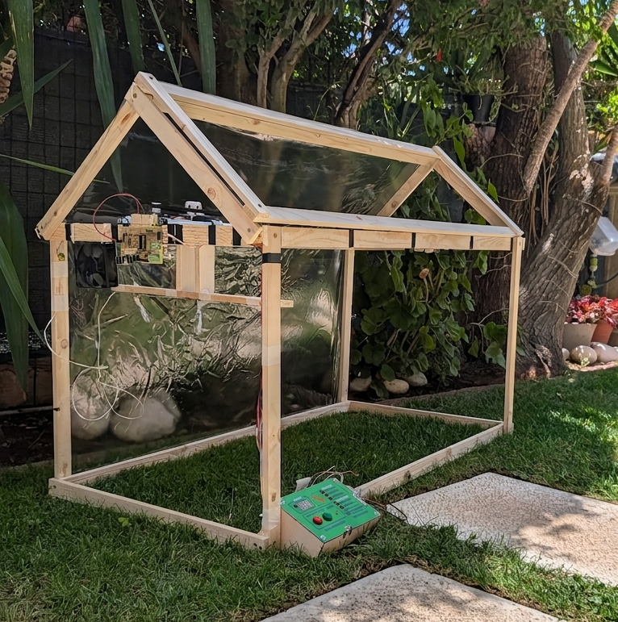
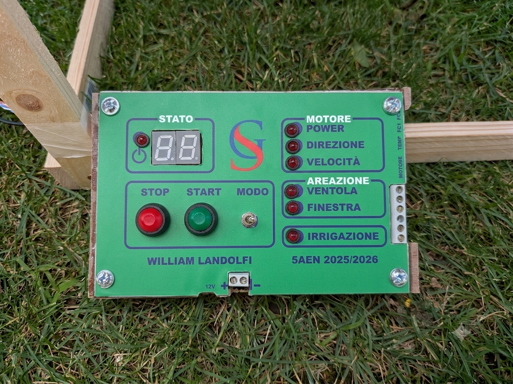
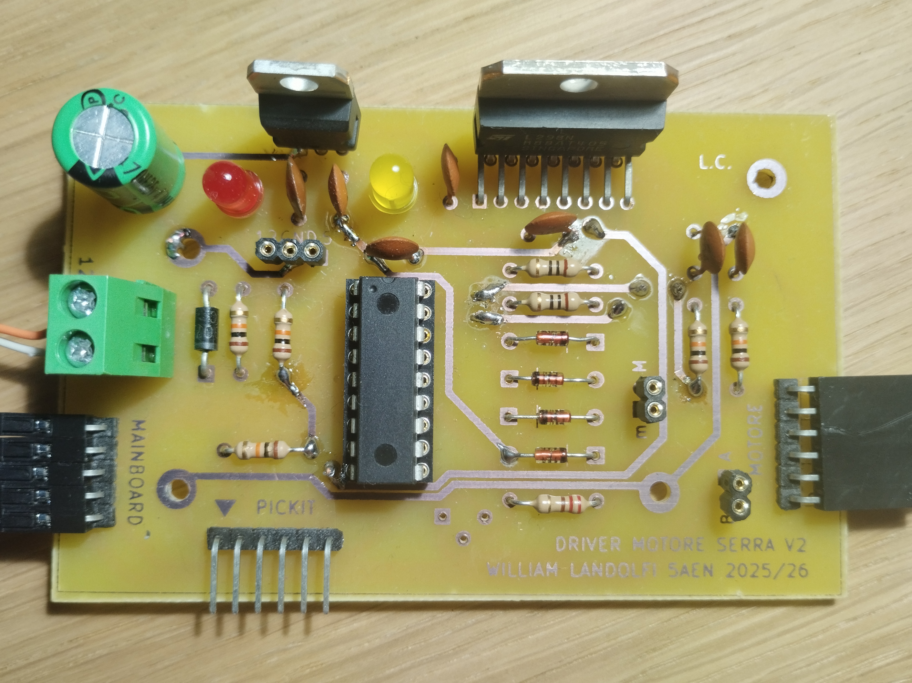
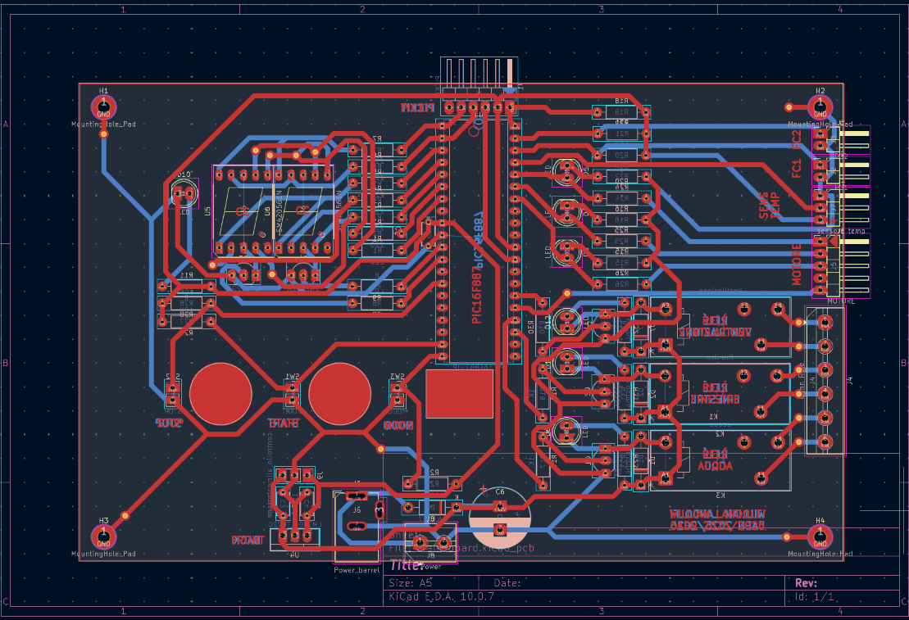
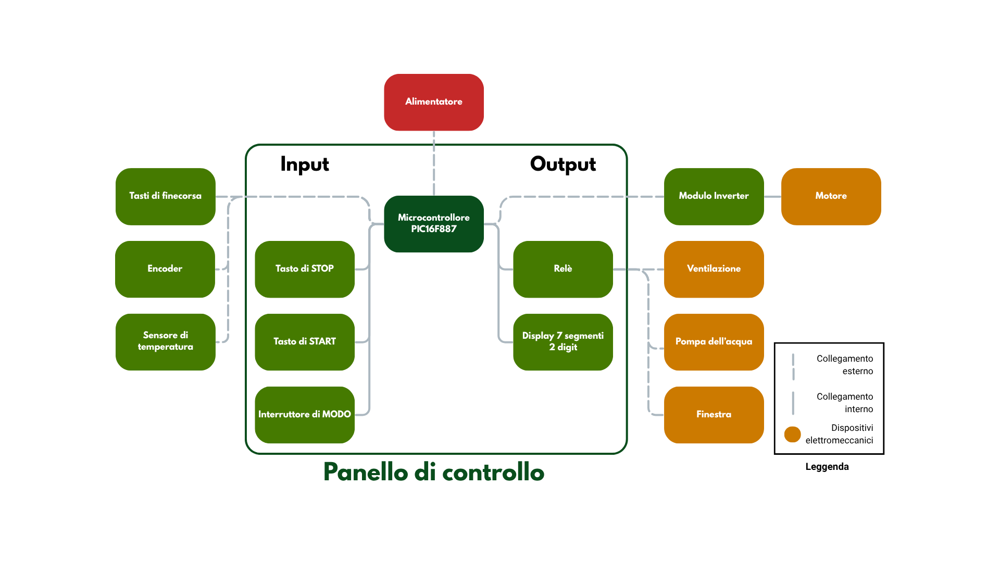

<div align="center">

# Serra automatizzata

### Sistema embedded per il controllo di una serra con microcontrollori Microchip PIC

<p>
  
  
  
</p>

*Un progetto pratico che integra firmware per microcontrollori, progettazione elettronica e controllo di sensori e attuatori.*

</div>

---

## Panoramica

Questa **serra automatizzata** è un progetto embedded sviluppato per riprodurre, su scala prototipale, alcuni elementi di un sistema di controllo per una serra industriale. Il sistema combina due microcontrollori **Microchip PIC16F887 e PIC16F88**, schede elettroniche progettate e realizzate appositamente, sensori di temperatura e attuatori per la ventilazione e il movimento dell'asta d'irrigazione.

Il progetto comprende sia la parte software — firmware dei microcontrollori — sia la parte hardware: schemi elettrici, progettazione delle PCB e integrazione dei componenti. Il repository raccoglie il materiale tecnico disponibile e offre una base per documentare il funzionamento del sistema e le successive evoluzioni.

> **Stato del progetto:** il sistema di base è stato realizzato. È in progetto un'evoluzione con funzionalità IoT e soluzioni di comunicazione più strutturate. Le funzionalità future sono indicate come tali e non come già implementate.

## Galleria del progetto

> **Aggiungi le fotografie reali del progetto** nella cartella `documentazione/immagini/`, usando i nomi indicati qui sotto. Le immagini verranno visualizzate direttamente nella pagina GitHub. Sono particolarmente utili una foto della serra completa, una foto per ciascuna PCB e un'immagine del layout in KiCad.


<div align="center">
  
  <p><em>Vista complessiva del prototipo</em></p>
</div>

<table>
  <tr>
    <td width="50%" align="center">
      
      <br/><em>Panello di controllo</em>
    </td>
    <td width="50%" align="center">
      
      <br/><em>Scheda per il controllo del motore</em>
    </td>
  </tr>
  <tr>
    <td colspan="2" align="center">
      
      <br/><em>Progettazione elettronica in KiCad</em>
    </td>
  </tr>
</table>

## Funzionalità e componenti

Il prototipo comprende i seguenti elementi, realizzati o integrati nel sistema:

| Sistema | Componenti |
|---|---|
| Panello di controllo | Microcontrollore Microchip **PIC16F887** |
| Driver motore |  **PIC16F88** e  il ponte h **L298N** |
| Sensore di temperatura | Sensore analogico **LM35** |
| Ventilazione | Ventola comandata dal panello di controllo|
| Apertura delle finestre | Relè utilizzati per comandare il meccanismo di apertura |
| Movimento della barra d'irrigazione | **Motore DC da 12V** con **Encoder**, gestito dal driver motore |
| Hardware custom | Schede **PCB** progettate e realizzate personalmente (compresa la fotoincincisione)|

I maggiori dettagli riguardo i sensori e degli altri componenti possono essere consultati negli schemi elettrici e nei datasheet presenti nel repository.

## Architettura del sistema

Il sistema adotta una struttura composta da un controllore principale e da una scheda periferica dedicata al motore. I due PIC non utilizzano un protocollo seriale standard per comunicare: lo scambio di comandi avviene tramite **semplici segnali digitali**, interpretati come livello logico alto o basso.

<div align="center">
  
</div>

*Il diagramma è una rappresentazione concettuale dell'architettura descritta. Per i collegamenti elettrici dettagliati fanno fede gli schemi del progetto.*

### Schede elettroniche e PCB

La parte hardware è stata progettata e realizzata nell'ambito del progetto, non assemblata esclusivamente usando moduli già pronti. Il repository include i materiali di progettazione elettronica sviluppati con **KiCad**.

La documentazione hardware è utile per:

- consultare gli schemi elettrici;
- esaminare il layout delle PCB;
- identificare i componenti e i relativi collegamenti;
- comprendere la separazione tra controllore principale e scheda periferica.

Quando possibile, è consigliato affiancare ai file sorgente di KiCad anche esportazioni PDF degli schemi, immagini del layout e fotografie delle schede fisiche assemblate.

## Firmware

Il firmware è organizzato in base al ruolo dei due microcontrollori:

- **Controllore principale — PIC16F887:** gestisce la logica centrale del sistema e interagisce con i sensori e gli attuatori previsti dall'architettura.
- **Controllore periferico — PIC16F88:** è dedicato al controllo del motore DC da 12 V tramite il ponte h **L298N** e riceve comandi dal controllore principale tramite segnali digitali.

I sorgenti sono disponibili nella cartella [`firmware/`](firmware/). Le istruzioni di compilazione e programmazione devono fare riferimento ai file di progetto e alla toolchain effettivamente utilizzata per il firmware, nonché **MPLAB IDE v6.20**.

> **Nota sulla comunicazione:** il collegamento tra i due microcontrollori è realizzato tramite livelli logici digitali. Non è implementato, nella versione descritta, un protocollo come UART, SPI o I²C.

## Struttura del repository

```text
Serra/
├── README.md
├── Firmware/          # Sorgenti dei firmware
├── Schemi/            # Schemi elettrici e progetti PCB (KiCad)
└── Documentazione/    # Relazione tecnica, datasheet e materiali di supporto
```

Questa è la struttura logica del progetto: alcuni nomi o sottopercorsi possono variare in base all'organizzazione effettiva dei file nel repository.

## Documentazione tecnica

Nel repository sono raccolti diversi tipi di materiale tecnico:

- **Relazione tecnica PDF:** descrizione formale del progetto, delle scelte progettuali e dei problemi riscontrati. 
- **Schemi e PCB KiCad:** sorgenti editabili della progettazione elettronica.
- **Datasheet:** documentazione dei produttori per consultare caratteristiche elettriche, pinout, limiti operativi e modalità d'impiego dei componenti.
- **Firmware:** codice dei microcontrollori impiegati nel prototipo.

Per facilitare la consultazione, è consigliato mantenere i datasheet raggruppati in una cartella dedicata e creare un piccolo indice con **sigla del componente**, **funzione nel progetto** e **nome del relativo PDF**.

## Sviluppi futuri

Il progetto è in evoluzione. Le direzioni di sviluppo considerate comprendono:

- integrazione di funzionalità **IoT** per il monitoraggio del sistema;
- impiego di protocolli di comunicazione più strutturati per la raccolta e la gestione dei dati dei sensori;
- ampliamento della documentazione e miglioramento della diagnostica;

Questi punti rappresentano obiettivi di sviluppo e non vanno intesi come funzionalità già presenti nella versione attuale.

## Autore e contatti

Progetto sviluppato da **William Landolfi**.

- GitHub: [@icewolf132](https://github.com/icewolf132)
- Repository: [github.com/icewolf132/Serra](https://github.com/icewolf132/Serra)

---

<div align="center">
  <sub>Serra automatizzata · Progetto embedded, progettazione elettronica e controllo di attuatori</sub>
</div>
